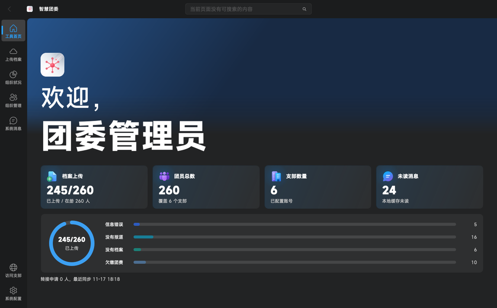
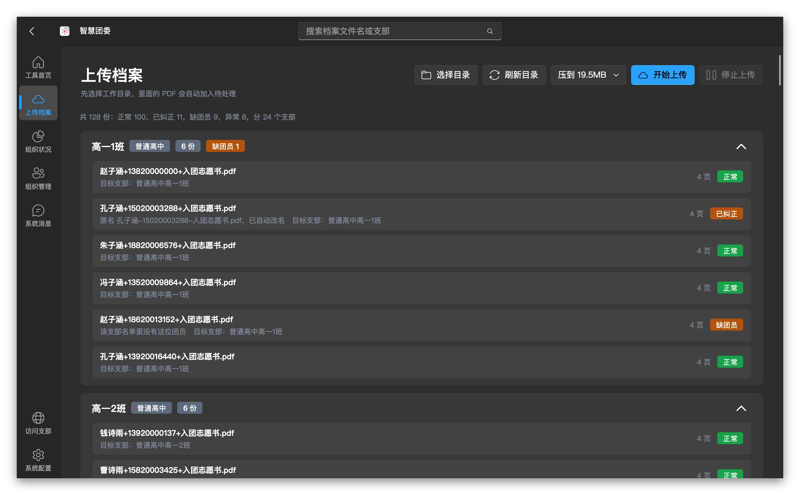
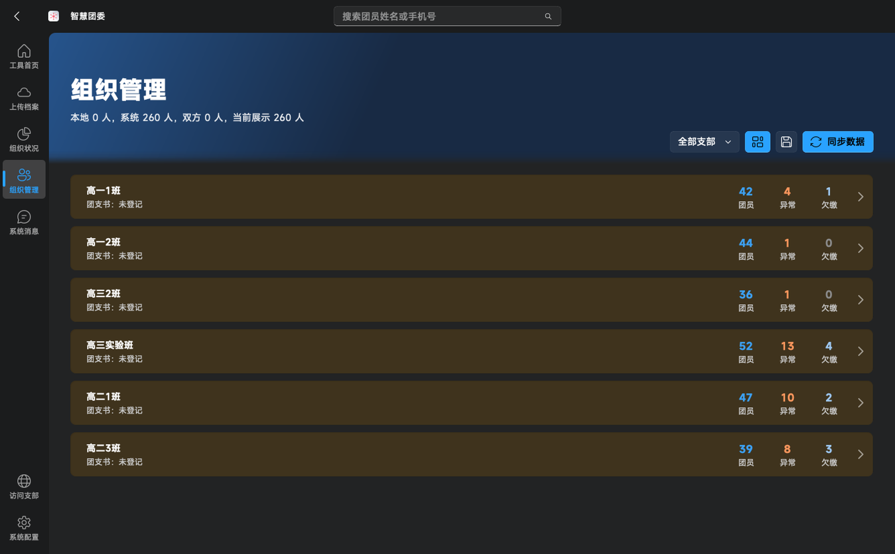
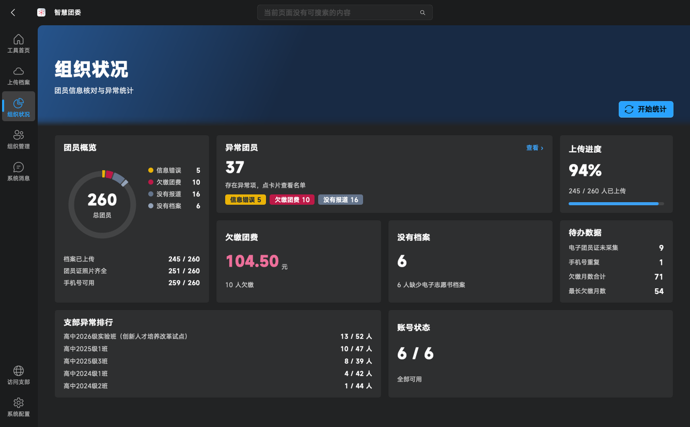
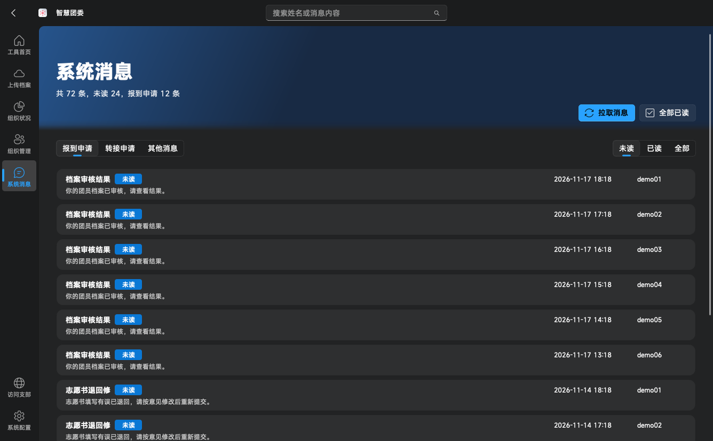
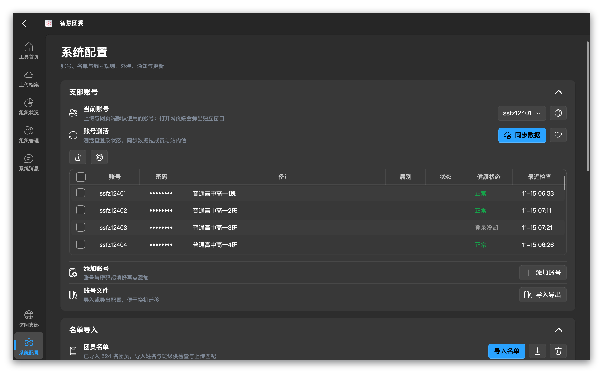

<div align="center">


# 智慧团委

多支部账号一屏管理：档案上传、组织状况、站内信与数据导出。

[![Release][release-shield]][release-url]
[![Downloads][downloads-shield]][release-url]
[![Python][python-shield]][python-url]
[![Qt][qt-shield]][qt-url]
[![License][license-shield]][license-url]

##### [下载安装][release-url] · [提交问题][issues-url] · [查看源码][repo-url] · [作者主页][author-url]

</div>

> [!TIP]
> 面向学校团委管理员的桌面工具。一个窗口里管几十个团支部账号：上传入团志愿书、核对报到与缴费、看支部异常、导出表格，不用在几十个浏览器标签之间来回切。手机端可以拍照扫描、查名单和看站内信，见下面的「手机端」。

## 特性

* **档案上传一条链。** 把几个文件夹一起拖进窗口，子文件夹里的 PDF 一并扫进来；命名自动纠正、页数自动核对、重复团员每组只留一份、文件按团支部分好组，点一次上传就完成压缩、登录、提交与自动审核。不通过的文件在列表里写清原因，不会悄悄漏掉。
* **几十个账号同时在线。** 内嵌浏览器给每个账号独立的会话存储，不同支部各开一个标签，互不顶掉登录状态。网页端、上传、测活共用一套会话管理，后台刷新不抢登录。
* **数据不只是数字。** 首页概览展示上传进度、团员与支部数量、四类异常和未读消息；组织管理可以逐支部看人，详情里的数字和条形图带过渡动画。
* **导出按需组合。** 五类内容（团员信息、未缴费、无档案、转接申请、信息错误）任选，始终导出一个 xlsx：分班时一个班一张表、各类异常都写在这张表的「异常」列里，合并时每项内容一张子表或全部合成一张。
* **跨学校可用。** 学号与账号编号规则可自定义，占位符描述年级、班号与忽略位，改示例编号就能实时看到解析结果。规则可以导出成 JSON 给别的学校用。
* **该省的都省了。** 已保存的会话优先复用，登录状态按账号 4 小时节流；更新在后台下载，装好之后才提示你确认重启，不打断手头的活。
* **三条分支各放一端。** 这个仓库按平台分分支：`main` 只放桌面端，`mobile-v2` 只放手机端，`server` 只放云端中转与备份函数。拉哪条分支就只看到哪一端的代码与构建说明。

* **手机直接传档案。** 同一 Wi-Fi 下扫二维码就能把手机里的 PDF 送到电脑；不在同一网络时用中转，走同一套配置提取码。详见「手机与电脑协同」。

## 界面预览

点击截图查看大图。

<table>
  <tr>
    <td align="center"><a href="screenshots/01-home.png"></a><br/><b>工具首页</b></td>
    <td align="center"><a href="screenshots/02-upload.png"></a><br/><b>上传档案</b></td>
  </tr>
  <tr>
    <td align="center"><a href="screenshots/03-org-manage.png"></a><br/><b>组织管理</b></td>
    <td align="center"><a href="screenshots/05-org-stats.png"></a><br/><b>组织状况</b></td>
  </tr>
  <tr>
    <td align="center"><a href="screenshots/06-messages.png"></a><br/><b>站内信</b></td>
    <td align="center"><a href="screenshots/07-settings.png"></a><br/><b>系统配置</b></td>
  </tr>
</table>

## 关于项目

| 平台 | 要求 | 架构 |
|:--|:--|:--|
| **macOS** | 13.0 及以上 | arm64 / x86_64 |
| **Windows 10 / 11** | 10 及以上 | x86_64 / x86（32 位） |
| **Windows 7** | SP1 | x86_64 / x86（32 位） |
| **Linux** | Ubuntu 22.04+ / Debian 12+ | x86_64 |
| **Android** | 12 及以上 | arm64-v8a / x86_64 |

> [!WARNING]
> 密码只保存在本机 `~/.gd12355-helper/config.json`，请自行做好磁盘加密与备份。工具只做正常登录能做的事，不会绕过站点风控；密码错误过多触发验证码时，在系统配置双击该账号，填密码和验证码即可恢复。

> Windows 7 包基于 Python 3.8（3.9 起要求 Windows 8+），与 Win10/11 包互不通用，按系统下载对应安装包。Windows 7 上的内嵌浏览器受 Chromium 版本限制，站点若已不再支持旧内核，账号网页标签可能打不开；上传、统计、导出等主流程不受影响。

> 窗口透明材质只在 Windows 11 上生效：**Mica** 取桌面壁纸的色调，**Acrylic** 实时模糊窗口后面的内容。Windows 10 的模糊接口会出黑块和发灰，所以那一档置灰，窗口铺纯色底，设置页写明原因。

## 快速开始

### 安装包

到 [Releases][release-url] 下载对应平台的安装包：macOS 用 dmg，Windows 用 `setup.exe`（每用户安装，不需要管理员权限，不弹 UAC），Linux 用 deb，Android 用 apk。首次启动在「系统配置」里填入团支部账号，或导入账号模板 xlsx。

换机时用「系统配置 → 系统备份 → 导出备份」把全部设置整份搬走：导出的是 config.json 快照，含账号、名单、工作区、通知、明暗模式、窗口材质、首页头图与编号规则；「恢复备份」会替换当前全部设置（先把旧配置另存一份）。只搬账号时用「支部账号 → 账号表格」。

### 从源码运行

依赖装在项目内的虚拟环境里。macOS 上直接 `python -m app.main` 通常指向系统/基础解释器，那边没有这些包，会报 `No module named 'qfluentwidgets'`；先激活 `.venv-qt5`。

```bash
python3.11 -m venv .venv-qt5        # 首次：用 3.11，与打包环境一致
source .venv-qt5/bin/activate       # Windows 用 .venv-qt5\Scripts\activate
pip install -r requirements.txt
python -m app.main          # 主窗口
python -m app.main --tray   # 托盘后台：定时检查 + 系统通知
python -m app.main --demo   # 演示数据：6 个支部、260 名团员，隔离在临时目录
```

不想激活环境时，直接用 `.venv-qt5/bin/python -m app.main --demo` 等价。

`--demo` 会新建一个临时配置目录并灌入演示数据（六成合规，其余分散在「没上传档案 / 身份信息缺项 / 志愿书未审 / 团费欠缴」，另含重复手机号与超长姓名、超长支部名），用于截图与排版验收。它不读写 `~/.gd12355-helper`，退出即弃，因此正式版安装包里没有任何测试数据入口。

只允许一个实例：重复双击图标只会把已有窗口叫到前面，不会开第二套窗口与后台同步线程。托盘菜单同样用 Fluent 圆角菜单（打开主界面 / 立即检查并通知 / 退出），不是系统原生的方形菜单。`--demo` 实例与正式实例各用一把单实例锁，可以同时开。

### 打包

```bash
pip install pyinstaller
python3 scripts/build.py            # 只打当前平台
python3 scripts/build.py --dry-run  # 只看命令，不打包
```

脚本用 PyInstaller 的 onedir 模式打包（运行时铺在安装目录，冷启动只加载 DLL）。产物固定：

- Windows：`dist/SmartYouth/智慧团委.exe`
- macOS：`dist/智慧团委.app`（前提是先按 workflow 里那一步生成 `build/SmartYouth.icns`）
- Linux：`dist/SmartYouth/`（workflow 用 dpkg-deb 打成 `.deb`）

> [!TIP]
> 打包后图标的两种落点（源码、PyInstaller 的 `_MEIPASS/assets`）由 `brand.assets_dir()` / `icons_dir()` 统一判断，新增图片仍只需放进 `app/assets/`。

### 发布

`scripts/release.py` 准备发布内容：更新应用版本号、在 CHANGELOG 顶部生成版本段、可选更新发布说明的前导文本。

```bash
python3 scripts/release.py --version 1.2.1 --since 8dd2b17 --include-types feat,fix,perf --dry-run
python3 scripts/release.py --version 1.2.1 --since 8dd2b17 --include-types feat,fix,perf
```

`--since` 指向上一个 release 提交；重写过历史后，旧 tag 可能不在当前分支上，用提交哈希更稳。`--include-types` 决定收录哪些提交类型，默认不含 `refactor`。版本段每行是 `- [短hash] <提交标题>`，文末 @ 贡献者。发布说明的前导文本（下载指引那一段）存在 `docs/release-intro.md`，`--intro` / `--intro-file` 不传就沿用原文件，改这段也可直接编辑该文件。

脚本只改本地文件，不 commit、不 push、不打 tag、不触发发布。检查 `git diff` 后自行提交；发布由维护者打 tag 触发 CI。

### Windows 安装包与代码签名

Windows 端用 [Inno Setup](https://jrsoftware.org/isinfo.php) 把 PyInstaller 的 onedir 产物打成正式安装程序：脚本是 `installer.iss`，构建时由 workflow 调用 `ISCC.exe` 编译。

- **不用单文件**：PyInstaller 的 `--onedir` 把运行时铺在安装目录里，启动直接加载 DLL；`--onefile` 要先解压到临时目录，冷启动明显慢。
- **每用户安装**：装到 `%LOCALAPPDATA%\Programs\智慧团委`，不需要管理员权限、不弹 UAC，因此不会出现「未知发布者」的提权提示。
- **可选的证书信任**：自签名的包里，安装向导最后一步有一个不勾选的「信任本次安装包的签名证书」。勾上会单独请求一次管理员授权，把证书装进「受信任的根证书颁发机构」，之后运行不再提示未知发布者；取消授权或跳过这一项都不影响应用使用。
- **SmartScreen**：双击下载来的安装包时，Windows 仍可能提示「已保护你的电脑」——这是对「下载来的 exe」的通行评判，与安装本身无关，点「更多信息 → 仍要运行」即可。

代码签名在 workflow 里自动完成：

- 配了仓库 Secrets `WIN_CERT_PFX_B64`（pfx 文件的 base64）和 `WIN_CERT_PASSWORD`，就用这把真实证书签名，终端不再提示未知发布者；
- 没配时，每次构建生成一把自签名证书并签名，同时把公钥 `SmartYouth-CodeSigning.cer` 随 Release 分发，安装包里也带一份。装进「受信任的根证书颁发机构」后，本地运行与安装就不再提示未知发布者——安装时勾选那一项即可，也可以事后双击 `.cer` 手动导入。

> [!TIP]
> 要彻底免提示，建议用真实证书。开源项目可申请 [SignPath.io](https://signpath.io/) 的免费代码签名（云端签名，需改用它的 GitHub Action）；或购买商业代码签名证书，把 pfx 的 base64 与密码放进上面两个 Secrets，签名步骤会自动接管。找不到证书或签名失败时该步骤只告警、不失败，安装包照常产出。

## 页面

| 页面 | 做什么 |
|---|---|
| 工具首页 | 欢迎区 + 上传进度圆环、支部异常条形图与概览磁贴（团员总数、支部数量、未读消息、四类异常） |
| 上传档案 | 拖入多个来源目录（含子文件夹）取件 → 文档检查（命名自动纠正、页数核对、支部团员核对、重复团员去重）→ 按支部预组织 → 压缩并逐支部提交 |
| 组织状况 | 上传进度圆环、异常分类条形图、异常团员名单（每小时后台自动统计），点团员卡片直接跳到该支部的成员列表 |
| 组织管理 | 支部列表与支部详情两级；搜索、全部/系统名单切换、同步数据、导出（一个保存按钮里选分班或合并） |
| 系统消息 | 报到申请 / 转接申请 / 其他消息分页签，未读已读分段筛选，一页 12 条分段翻页，点开消息直接打开对应账号网页 |
| 系统配置 | 支部账号、名单管理、上传规则、外观设置、工作与通知、关于项目；每张卡片有简短说明，右侧最多两个同宽控件（按钮、下拉框、输入框统一 126px，带图标四字），放不下的次要项收进行尾下拉；「全部测活」在右下角显示进度条，结束给一条按原因归并的汇总；健康状态异常时点那一格恢复登录，验证码类异常直接填密码和验证码 |

> [!TIP]
> 侧边栏「访问支部」在系统配置上方，点开的是内嵌浏览器窗口；新建标签会先问要访问哪个支部。

> [!TIP]
> 搜索框固定在窗口标题栏中央，组织管理搜团员、系统消息搜消息内容、上传档案搜文件名与支部；
> 切换页面时自动换提示语并清空关键词。

## 手机端

Android 原生端用 Kotlin + Compose + Miuix 构建，源码在同仓库的 `mobile-v2` 分支，构建说明见那条分支的 README。当前版本 2.2.1，安装包随桌面端 Release 一起发布。

底部五个标签：首页、名单、扫描、消息、我的。

| 标签 | 做什么 |
|---|---|
| 首页 | 上传进度、四类异常分布、未读消息入口、账号与同步状态 |
| 名单 | 团员搜索与筛选，离线可读本地缓存；点团员可直接为他扫描 |
| 扫描 | 拍照或相册导入 → 多页预览 → 逐页拉四角、旋转、滤镜 → 补齐姓名与手机号 → 生成 PDF。扫描件存在本机，可打开、分享、上传 |
| 消息 | 站内信按报到 / 转接 / 其他分类 |
| 我的 | 账号、扫描默认参数、主题、关于 |

站点协议移植自桌面端 `app/services/api.py` 与 `app/domain/*`：登录（double-MD5、验证码）、组织树、团员分页、站内信、分片上传与审核。Cookie 按账号分别持久化，切换账号不会顶掉另一个登录态。命名规则和桌面端一致：`姓名+手机号+入团志愿书.pdf`。生成的 PDF 会按目标体积自动降质量，满足站点单文件 10MB 上限。

账号密码与会话 Cookie 只存在应用私有目录；扫描件存在 `getExternalFilesDir("documents")/scan`，卸载应用时清除。纸边检测依赖 OpenCV，加载失败时退化为整幅图加内边距，仍可手动拉四角。

## 手机与电脑协同

上传页点「手机同步」会起一个本地 HTTP 服务（默认 8765，被占用时由系统分配），只接受来自私有网段的请求。弹窗给出二维码和完整地址；同一 Wi-Fi 下用手机扫码，就能把 PDF 传到电脑，落盘到 `~/同步自手机/<日期>/`，按 SHA-256 判重，并自动登记为来源目录。

手机和电脑不在同一网络时走中转：手机把文件分片传到中转服务，电脑端自动取回。两条路用同一个配置提取码。协议细节见 `docs/app-pair-protocol.md`，设计取舍见 `docs/phone-sync-design.md`。

## 响应速度

启动画面先上屏，再导入 qfluentwidgets、构造窗口与页面；画面与主窗口同尺寸同底色，接棒时看不到接缝。Python 模块在启动时由 PyInstaller 的冻结导入器加载；PyMuPDF 这类带原生库的依赖由专用 hook 原样收集，不进入编译阶段。

消息多、页面控件多时最容易卡住的两处，都按「不在界面线程做重活」处理：

- **系统消息读取**：消息、成员、已读三份缓存合起来可达数 MB，配置读取与组装放到后台线程，读完后才回界面。列表一页 12 条，单页内再分两批建卡，翻页只重建当前页；缓存指纹没变时整页跳过。左侧页签、右侧未读/已读切换都重新从第一页开始，翻页控件放在统计行右侧，首屏就能看到。
- **明暗模式切换**：`setTheme` 会让整个窗口重算一遍样式表，这段计算必然占住界面线程。切换时先让页面淡出（约 110ms），在透明帧里完成换肤，再淡入（约 170ms），看到的是颜色平滑过渡而不是画面定格。消息卡片的标签改成按主题现绘的自定义标签，切主题不再重建上百个控件。

## 上传档案

1. **来源目录可以放多个。** 把文件夹直接拖进窗口任意位置，或点「添加文件夹」多选；子文件夹一并扫描。「来源目录」是一张折叠卡，里面的每个文件夹只是普通卡片：名称、完整路径、份数与移除；文件清单统一在下方按支部分组，不再按目录重复列一遍。已在列表里的目录、以及被已添加目录包含的子目录会跳过。
2. **命名不对的挡在外面。** 文件名里解析不出「姓名+手机号」的 PDF 按与档案无关处理，不进上传计划；概览下方用一行灰字告诉你有多少份被忽略，不悄悄丢。`__MACOSX`、`.git` 这类垃圾目录直接跳过。
3. 进入页面即自动检查：命名能解析但格式不标准的直接改成 `姓名+手机号+入团志愿书.pdf`；页数不符、命名解析不出、路由不到支部的标为异常。
4. **重复团员只留一份。** 同一团员有多份档案时，每组保留一份可用的，其余标「重复」并写明与哪份重复；公告里给一条「重复档案 N 份」，删掉多余的再点「重新扫描」。
5. 同时核对支部团员名单：用本地缓存按「姓名 + 手机号」查该支部有没有这个团员，查不到标「缺团员」，但不拦上传——名单可能是放学籍之后才变的。
6. 文件行按支部分组；卡片标题只写班名，学段、份数、待处理数用标签挂在右侧。
7. 点「上传」：先把超过 9.5MB 的文件压到 9.5MB 以内，再逐个支部登录提交，上传成功后自动调审核接口。整批结束只发一条消息，报成功导入的份数与需要手动审核的份数。

## 导出数据

五类内容：所属团员信息表、未缴费团员名单、无档案团员名单、转接申请名单、信息错误名单。

点组织管理右上角的保存按钮，弹窗里一次定三件事：

- **内容**：五类内容任选，至少选一项。
- **范围**：分班导出（每个班一张子表）或合并导出（全部班合在一起）。
- **呈现**：每项一表（每个选项一张子表）或合成一表（全部进同一张表，多一列「类别」）。只在合并导出时可选。

导出始终只落**一个 xlsx**。分班导出时一个班一张子表，勾中的团员信息与各类异常都在同一张表里，每人一行，靠最后一列「异常」写清他具体是哪一类问题（欠缴写金额与月数、无档案、信息错误项、转接状态，多项用「；」隔开）——不用在几张表之间对照同一个人的不同毛病。分表的依据是团员自己的所属组织，一个账号管着几个班时会自动拆到各自的班。合并导出时每项内容一张子表，或全部合成一张。工作表名超过 31 个字符会截断，重名自动加序号，不覆盖。

数据来自本机成员缓存与组织状况缓存，导出不发起网络请求；还没有缓存时用组织状况的异常名单兜底，不会导出空表。

保存对话框的默认文件名会写清是什么表、怎么导的、什么时候导的，例如
`导出数据-分班导出-团员信息+未缴名单-20261115-0205.xlsx`。

## 编号规则

每所学校编号都不一样，规则在「系统配置 - 编号规则 - 编辑规则」里写。一行一条，用竖线分三段：

```
编号模式|学部|年级名称
```

| 占位符 | 含义 |
|---|---|
| `{yy}` | 入学年两位，加世纪基准得到年份 |
| `{yyyy}` | 入学年四位 |
| `{g}` `{gg}` | 年级序号一位或两位 |
| `{c}` `{cc}` `{ccc}` | 班号一位、两位、三位 |
| `{n}` `{nn}` `{nnn}` | 忽略位，如校验位或流水号 |

默认规则：

```
1{yy}{cc}|普通高中|高一,高二,高三
2{yy}{cc}|国际高中|高一,高二,高三
{yy}{cc}|初中部|初一,初二,初三
```

其他写法举例：

| 学校编号 | 规则 |
|---|---|
| `X202407`，六年制小学 | `X{yyyy}{cc}|小学部|小一,小二,小三,小四,小五,小六` |
| `071`，班号在前，末位年级 | `{cc}{g}|初中部|七年级,八年级,九年级` |
| `G24071`，字母学部前缀，末位校验位 | `G{yy}{cc}{n}|国际部|高一,高二,高三` |

规则同时用于账号备注预填、组织管理分组排序与批量导入的账号列识别。改规则时只同步旧规则自动生成的备注，手填备注保持原样。

## 账号网页

同一浏览器里多个账号共享 cookie，后登录的会顶掉前一个会话。账号网页是**独立窗口**（不占侧边栏），每个账号一份独立的浏览器存储（`~/.gd12355-helper/webprofiles/<账号>`），标签之间互不影响：

- 入口四个：侧边栏「访问支部」（在系统配置上方）、「系统配置 - 当前账号 → 打开网页」、系统消息里点开一条消息、账号表里双击某一行。
- 窗口和主窗口一样接管系统标题栏：标题栏按系统红绿灯的中线定高（macOS 42px、Windows 32px），标签条、加号、后退 / 前进 / 刷新 / 重新登录与窗口按钮共用一条垂直中线。打开时停在欢迎页，点「开始访问」或「＋」弹出支部选择框；账号状态异常也照样列出来并标注原因，能直接开网页端手动恢复。
- 打开标签时在标签页内打开登录接口，由服务端下发会话 Cookie，再进系统首页 `/bg/index_main.html`。登录接口的正文是一段 JSON，那几秒用转圈遮罩盖住，不露出来。
- 登录结果读接口返回的 JSON：成功才进首页；要验证码或密码错时落到登录页，可以直接在窗口里输入。页面出现「登录状态已失效」会自动重登，连续两次不成功才停下来等人工处理。
- 「重新登录」先清掉该账号存储里的旧 Cookie 再登录，避免两条同名会话同时到达被判「登录状态已失效」；标签右侧的叉关闭标签，释放页面与存储。
- 标签横向排列最多 6 个，放不下时等比缩小并渐隐文字，不会盖住右侧按钮。关掉窗口不销会话，下次打开仍在；关掉主窗口时这一整窗跟着关掉。

## 自动更新

「系统配置 - 关于项目」里可以开作者主页、提交反馈、检查更新。桌面端和手机端共用同一个 Release 页面，各取自己的安装包。

- 来源固定为 `IsSmallPigPig/Smart-YLC`：桌面端按平台挑安装包（macOS 取 dmg、Windows 取 exe、Linux 取 deb），手机端从所有 Release 的 apk 资产里按文件名取最高版本（兼容旧的 `mobile-v*` 发布）。
- 桌面端启动后延迟 2.5 秒静默检查；发现新版本就在后台下载。下载完成后弹一条常驻提示，按钮变成「待重启」；**安装要由你确认**，点「重启」才会退出主程序、交给独立进程静默安装，装完自动打开新版本。源码运行时不会自动重开。手动检查与下载仍用右下角浮动进度条展示（检查时为扫描进度，下载按百分比推进）。
- 手机端发现新版本后停在「待安装」，点确认才拉起系统安装器；安装包下载后会按 GitHub 给出的 SHA-256 摘要校验，镜像站返回的内容对不上就换下一个站。
- 镜像源集中在 `updater.MIRRORS` 维护：二十多个公开加速站，末尾留直连 GitHub 兜底。设置页「检查更新」那一行左边就是镜像源选择——默认「自动选择」，点开先并发测速，站名后面跟本轮实测延迟（`(845 ms)`），没通的标「(超时)」「(不可用)」；也可以指定某一个站，或填自定义站址。选完直接开下，不再每次问走哪个站；指定的站失败会自动按顺序换下一个。站失效了改 `MIRRORS` 一处即可。包落在 `~/.gd12355-helper/updates/`，用 `.part` 加原子替换。
- 安装由独立进程完成：Windows 对 setup.exe 用 `/VERYSILENT /NORESTART /SUPPRESSMSGBOXES /CLOSEAPPLICATIONS`（MSI 用 `msiexec /qn`），macOS 挂载 dmg 后把 `.app` 复制到「应用程序」。
- 助手拉不起来或安装失败时保留更新包，按钮回到「打开目录」，并在系统通知里说明需要手动安装。
- macOS 打包版的后台提醒走系统原生通知，点击会回到对应页面；源码运行没有 bundle id 时回落到应用内浮窗。首次发送需要允许通知权限。
- macOS 上 Python 不读系统钥匙串，检查前会把系统受信任根证书补进 `SSLContext`，证书校验始终开启。
- 推 `v*` tag 会触发 `.github/workflows/release.yml`，构建 macOS、Windows 10/11（32/64 位）、Windows 7（32/64 位）、Linux 六个桌面安装包，以及 Android APK，一起发布到 Release。APK 的源码取自 `mobile-v2` 分支，构建日志里会打出发的是哪个提交。

## 数据与配置

桌面端全部数据在 `~/.gd12355-helper/`：

| 文件 / 键 | 内容 |
|---|---|
| `config.json` | 账号、名单路径、编号规则、外观、通知频率等；来源目录存成 `workspaceDirs` 数组，旧版本的单值 `workspaceDir` 会自动读成一项 |
| `config.json.bak` | 上一次成功写入的备份，主文件损坏时自动回退 |
| `pending_uploads.json` | 待上传的散件（拖进来的单个 PDF）列表 |
| `webprofiles/` | 每个账号独立的浏览器会话与缓存 |
| `updates/` | 下载的更新包 |
| `memberCache` | 各支部团员快照，30 秒同步写入 |
| `messagesCache` / `messagesRead` | 站内信缓存与本地已读标记 |
| `orgStatsCache` | 组织状况统计与错误名单 |

同步系统数据每 30 秒一轮，只用已保存会话取数，不登录；刷新登录状态是独立操作，按每个账号最后刷新时间做 4 小时节流。

## 命令行

不带界面跑完整业务，给脚本和 AI 用。命令在仓库根执行，加 `--json` 得到机器可读结果：

```bash
# 一个常见场景：从一堆扫描件到上传完，全程不必开界面
python3 cli.py scan ~/Downloads/档案 --json          # 先看命名、页数、支部、重复
python3 cli.py cells ~/Downloads/档案                 # 逐格查主信息表空格
python3 cli.py org sync --yes                        # 同步团员名单，路由才有依据
python3 cli.py upload ~/Downloads/档案                # 不带 --yes：预演，只报计划
python3 cli.py upload ~/Downloads/档案 --yes          # 确认后：压缩副本→上传→审核
```

安装包里也带命令行，不用另装 Python。打开终端，按系统选一条（路径是默认安装位置）：

```bash
# macOS：从 dmg 把「智慧团委」拖进应用程序后
"/Applications/智慧团委.app/Contents/MacOS/SmartYouthCLI" scan ~/Downloads/档案 --json

# Windows：默认装到 %LOCALAPPDATA%\Programs\SmartYouth
"%LOCALAPPDATA%\Programs\SmartYouth\SmartYouthCLI.exe" scan "%USERPROFILE%\Downloads\档案" --json

# Linux：.deb 默认装到 /opt/SmartYouth
/opt/SmartYouth/SmartYouthCLI scan ~/Downloads/档案 --json
```

命令行与界面读写同一份配置（`~/.gd12355-helper/config.json`），界面里同步的名单、登录状态，命令行直接可用。下文示例里的 `python3 cli.py`，在安装包里换成上面对应的路径。

`scan` 和 `cells` 默认只读，不改文件、不写缓存、不联网。`upload` 不带 `--yes` 时只报告会提交哪些支部、多少份；带 `--yes` 才真的压缩、上传、请求自动审核。其余会写盘或改配置的命令（改名、同步、导入、恢复备份、开机自启……）也遵循同一约定。

加 `--json` 后标准输出只有一个对象，别的文字都走标准错误：

```json
{"schema": 1, "ok": true, "command": "scan", "data": {"counts": {}, "files": []}, "warnings": []}
```

失败时 `ok` 为 false，`error.code` 说明原因（`missing_dir`、`config_unreadable`、`needs_yes`、`internal` 等）。退出码：0 命令执行成功（业务是否成功看 `data`），2 参数不对，3 前置条件不满足，4 运行出错。`--config-dir <目录>` 换一份配置。

完整命令（每组用 `--json` 都能拿到上面的信封）：

| 组 | 命令 | 作用 |
| --- | --- | --- |
| 检查 | `version`、`doctor`、`scan DIRS... [--fix --yes]`、`cells PATHS...` | 环境自检、档案检查、表格空格检查 |
| 上传 | `upload DIRS... [--account 关键字] [--yes]` | 预检查→压缩副本→按支部提交→自动审核 |
| 登录 | `login probe [--account 关键字] [--yes]` | 逐账号测活；`--yes` 把状态写回配置 |
| 站内信 | `messages pull [--yes]`、`messages list [--unread]`、`messages read KEY...\|--all [--yes]` | 拉取、查看、标记已读 |
| 组织 | `org sync [--yes]`、`org stats [--online] [--yes]`、`org tree 账号` | 同步团员、统计汇总、组织树 |
| 导出 | `export --contents members,fee,archive,transfer,identity --out PATH [--yes]` | 从缓存导出 xlsx |
| 备份 | `backup list`、`backup probe`、`backup push --password 四位数字 --yes`、`backup pull --out PATH --yes` | 云端配置备份与恢复 |
| 手机传档 | `pair serve [--minutes 5] --yes`、`pair pull --yes`、`pair list`、`pair forget 名称 --yes` | 局域网接收、中转拉取、配对设备管理 |
| 配置 | `config get [KEY]`、`config set KEY VALUE --yes`、`config export PATH --yes`、`config import PATH --yes`、`config dirs list\|add\|remove PATH [--yes]` | 读写整份配置与来源目录 |
| 名单 | `roster import XLSX [--semester 学期] --yes`、`roster use 学期 --yes`、`roster delete 学期 --yes`、`roster template --out PATH --yes` | 分学期团员名单 |
| 团支书 | `secretary import XLSX --yes`、`secretary template --out PATH --yes` | 团支书名单与模板 |
| 系统 | `autostart status\|on\|off`、`rule show\|explain CODE`、`update check\|download --yes`、`announce fetch`、`daily-check`、`logs --out PATH --yes` | 自启、编号规则、更新、公告、每日检查、日志 |

`backup pull` 只把解密结果写到文件；确认内容后用 `config import PATH --yes` 替换配置，替换前会自动留一份 `.before-import-*` 备份。登录遇到验证码时，CLI 会明确报出来；到界面「系统配置」双击该账号，填密码和验证码就能继续。

## 测试

```bash
python3 -m pytest tests/ -q
```

覆盖命名与页数检查、上传检查与路由、检查规则、登录协议、分片协议、登录闸门、网页会话、跨学校编号规则、导出数据、通知节奏、更新服务、命令行契约，以及界面构造冒烟。全部使用纯函数或假客户端，不发网络。另有 `scripts/lint_copy.py` 检查用户可见文案，`scripts/lint_patterns.py` 检查代码反模式，两者都要求零问题。

## 协议来源

接口协议来自对 `tuan.12355.net` 的只读侦察：

- 登录 GET `/login/adminLogin`，password = md5(md5(明文))，带 weakPass 标记
- 团员列表 POST `/api/v1/admin/members/page`，带 `authorize_name` 头
- 分片上传 `/file/breakpoint-upload`（10MB 分片）→ `/file/add` 入库
- 密码错一次触发验证码：双击账号行填密码和验证码，登录成功后再上传

## 贡献

欢迎提 issue 或 PR：复现步骤、截图、日志里的错误原文都很有用。改动涉及网络协议时，请一并补上对应的纯函数测试。新增用户可见文案或修掉一类代码缺陷时，按 `scripts/lint_patterns.py` 文件头的说明补规则和回归测试。

## 许可证

本项目以 [GNU General Public License v3.0](LICENSE) 发布：可以自由使用、修改与再分发，衍生的程序也必须同样以 GPLv3 开源并附上源码。

<div align="center">

本项目由广州天省实验学校 12407 欧阳文俊 @IsSmallPigPig 开发。

</div>

<!-- MARKDOWN LINKS & IMAGES -->
[release-shield]: https://img.shields.io/github/v/release/IsSmallPigPig/Smart-YLC?style=for-the-badge
[release-url]: https://github.com/IsSmallPigPig/Smart-YLC/releases/latest
[downloads-shield]: https://img.shields.io/github/downloads/IsSmallPigPig/Smart-YLC/total?style=for-the-badge
[python-shield]: https://img.shields.io/badge/Python-3.11%2B-blue?style=for-the-badge&logo=python&logoColor=white
[python-url]: https://www.python.org/
[qt-shield]: https://img.shields.io/badge/Qt-PyQt5-41cd52?style=for-the-badge&logo=qt&logoColor=white
[qt-url]: https://doc.qt.io/qtforpython/
[issues-url]: https://github.com/IsSmallPigPig/Smart-YLC/issues
[repo-url]: https://github.com/IsSmallPigPig/Smart-YLC
[license-shield]: https://img.shields.io/badge/License-GPL--3.0-blue?style=for-the-badge
[license-url]: https://github.com/IsSmallPigPig/Smart-YLC/blob/main/LICENSE
[author-url]: https://github.com/IsSmallPigPig
